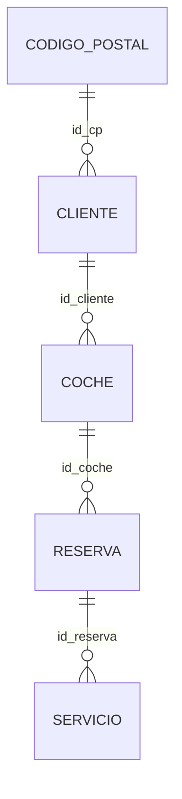

<p align="center">
  
</p>

<h1 align="center">Talleres Moises · Aplicación PHP</h1>

<p align="center">
  <em>Mecánica · Reparación | Profesionalidad y confianza</em>
</p>

<p align="center">
  
  
  
  
  
  
</p>

---

## Sobre el proyecto

Proyecto de la asignatura **Desarrollo de Interfaces (2º DAM)**, segunda parte.
Temática: **Taller Mecánico de Vehículos**.

Aplicación web (SPA) para controlar el flujo de reparaciones de los clientes del taller: gestión de clientes, coches, reservas y servicios, con PHP y MySQL en el servidor y JavaScript (AJAX) en el cliente.

La primera parte (web corporativa estática) está en el repositorio [Talleres-Moises](https://github.com/L3V1XX/Talleres-Moises).

## Enlaces

- 💻 **Repositorio GitHub:** [talleres-moises-php-app](https://github.com/carmen-404/talleres-moises-php-app)
- 🌐 **Alojamiento web:** <!-- TODO: pegar aquí la URL del hosting --> https://PENDIENTE

## Conexión a la base de datos (`config.php`)

| Parámetro | Valor |
|---|---|
| Servidor | `db` |
| Puerto | `3306` |
| Base de datos | `talleresMoises` |
| Usuario | `root` |
| Password | `test` |

> Los scripts SQL están en la carpeta `sql/`:
> - `backup.sql`: crea la base de datos `talleresMoises`, las tablas, relaciones y datos.
> - `backup_sin_create_database.sql`: igual, pero sin `CREATE DATABASE` (para hostings donde la base de datos ya viene creada).

## Puesta en marcha
1. Copiar la carpeta en `www/` (docker-lamp) y abrir `http://localhost/talleres-moises-crud-php/`.
2. Importar `sql/backup.sql` (crea BD, tablas, relaciones y datos). Si la BD ya existe: `sql/backup_sin_create_database.sql`.
3. Requiere PHP 7.4+ con mysqli y MySQL 8.0.16+ / MariaDB 10.2.1+ (restricción `CHECK` de `franja_horaria`).
4. Las imágenes se guardan en la BD (columna `imagen`, BLOB): máximo 2 MB (límite por defecto de `upload_max_filesize`)

### Entidades (modelo relacional)


- Todas las claves primarias son `id` autoincremental. `CODIGO_POSTAL` no tiene CRUD (solo alimenta el desplegable de clientes).
- `RESERVA`: única por (`id_coche`, `dia`, `franja_horaria`); la franja solo admite `MANANA` o `TARDE`.
- **Tiempo y precio estimados** (`tiempo_calculado`, `precio_calculado`): no se editan nunca a mano. Valen 0 al crear la reserva
  y se recalculan solos sumando sus servicios cuando se crea, modifica o borra un servicio.
- Borrado: sin `ON DELETE`, no se puede borrar un registro con hijos y se explica el motivo.

Los nombres de tabla están en MAYÚSCULAS (en Linux, MySQL distingue mayúsculas y minúsculas).

## Reparto de responsabilidades

| Alumno | Entidad responsable |
|--------|---------------------|
| Carmen | `Reserva` |
| Moises | `Servicios` |
| Jose Manuel | `Coche` |
| Javier | `Cliente` |

## Tecnologías

- HTML5, CSS3 y JavaScript (AJAX)
- [Bootstrap 5.3.3](https://getbootstrap.com/) y [Bootstrap Icons](https://icons.getbootstrap.com/) 1.11.3
- PHP y MySQL
- Tipografías locales en WOFF: Oswald (títulos), Roboto (cuerpo), Montserrat (navegación y botones)

## Estructura del proyecto

```
talleres-moises-php-app/
│   alta_cliente.php
│   buscar_cliente.php
│   cabecera.html
│   config.php
│   editar_cliente.php
│   funcionesBD.php
│   imagen.php
│   index.php
│   listado_clientes.php
│   listado_clientes_filtro.php
│   pie.html
│   proceso_alta_cliente.php
│   proceso_borrar_cliente.php
│   proceso_buscar_cliente.php
│   proceso_modificar_cliente.php
│   README.MD
│
├───css
│       admin.css
│       style.css
│
├───img
│   ├───favicon
│   │       favicon.svg
│   │
│   └───logo
│           logo.svg
│
├───inc
│       entidades.php
│
├───sql
│       backup.sql
│       backup_sin_create_database.sql
│       seed_data.sql
│
└───uploads
    │   .htaccess
    │
    ├───clientes
    ├───coches
    ├───reservas
    └───servicios
```


## Requisitos

- PHP 8.0 o superior
- MySQL 8.0.16+ o MariaDB 10.2.1+
- Servidor web Apache
